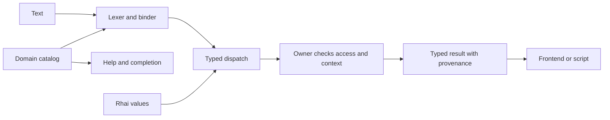

# Operation syntax and ownership

## Local scripting adapter

`console-scripting` is an optional client application feature in both desktop
and terminal graphs. The catalog always declares `client.scripting.run_file`,
`client.scripting.status` and `client.scripting.cancel` with local-job/query
effects. With the feature off, the host returns the typed
`ConsoleScriptingDisabled` capability refusal. With it on, an explicit host
invocation starts one Rhai worker; the worker reads one UTF-8 file of at most
16 KiB from a captured working directory. Script control entries are
`scriptable=false`. `f1_get`, `f1_set` and `f1_call` resolve scriptable paths
through catalog metadata and submit bounded typed values to the same owner
dispatch used by F1 and terminal input. The worker owns Engine, Scope and AST;
the client application step pumps requests through a one-place channel. A
submitted operation handle records a request, not an owner commit.

The first-run limits are 20,000 Rhai operations; one run; 32 owner calls,
including at most eight mutations and one pending mutation; a 64 KiB response
ceiling (the current neutral result codec is stricter at 32 KiB); 256 KiB
aggregate result; 32 KiB print/debug; 8 KiB strings; 256 array entries;
64 map fields; 16 call levels; 10 s monotonic cooperative deadline and 5 s
per host wait. Eval and modules are disabled. Cancellation prevents new
submissions and leaves committed effects intact. Compile and native filesystem
read have no forced OS timeout. Runtime scenarios remain deferred.

E051 target contract. The [compatibility matrix](compatibility.md) records which spellings exist at the audited revision. An operation consists of an identity, the requested access and typed arguments. Metadata describes the operation to each host. Live state flows through its owner.



| Public path | State owner | Scope | Read source | Commit boundary |
| --- | --- | --- | --- | --- |
| `ui.locale` | Client settings | Local UI | SettingsStore and configured source | Apply session preference |
| `client.camera.fov` | Client settings and camera adapter | Local camera | Requested preference and effective camera | Record override and effective capability |
| `client.sky.meteors.rate` | Cosmetic spawner | Local sky | Client setting and presentation timeline | Local spawner settings |
| `server.sky.bolid_interval` | Server bolid scheduler | Shared server | Resolved config and scheduler | Change schedule on owner lane |
| `player.movement.speed` | Server movement policy | Current session actor | Confirmed policy replica | Validate context and DeveloperMovementPolicy, apply field patch |
| `world.time.scale` | EnvironmentClock | Shared simulation | Session sample or admin owner snapshot | Server command boundary |
| `world.primary.generation.seed` | Primary world manifest | Primary instance | Resolved seed and actual primary manifest | Creation, then read-only |

Preserve precise names such as `client.graphics.sky_quality`, `client.weather.cloud_detail` and `client.debug.atmosphere`. Resolve `world.seed` to the primary manifest even after a transfer. The active actor membership and a pending destination each carry their own context. Capture the actor context when preparing an invocation and validate it on execution. Explicit admin instance arguments select that instance after authorization.

## Grammar

```text
statement  = path | path "=" literal | path "(" [arguments] ")" | legacy
arguments  = literal { "," literal }
path       = segment { "." segment }
segment    = one or more lowercase ASCII letters, digits or underscores
```

One complete statement occupies one UTF-8 line of at most 512 bytes. Allow whitespace around separators. Preserve the registered spelling `server.dev-mode` as a path exception. A field read is bare, a write uses assignment, and every method takes parentheses. Keep explicit `get KEY`, `set KEY VALUE`, `reset KEY`, `list [PREFIX]` and `help [TARGET]`. Resolve the longest registered legacy name before examining its raw tail. Bind once. Known malformed canonical input yields a typed diagnostic with a byte range.

Accept booleans `true` and `false`, schema enum tokens, finite numbers, exact typed integer IDs and double-quoted strings. Decode `\"`, `\\`, `\n`, `\r`, `\t` and valid Unicode scalar escapes `\u{...}`. Punctuation inside strings is data. Legacy rest-text preserves the original tail. Quoted legacy scalars such as `fov "90"` decode before validation. Schemas supply units. Decimal clock scale uses at most six fractional digits. ID codecs preserve all 64 or 128 bits.

| Input | Meaning or diagnostic |
| --- | --- |
| `world.time.scale` | Read the source available to this host, with age and revision |
| `world.time.scale = 1000` | Request 1000× through owned admin control |
| `world.time.status()` | Read a typed clock report |
| `player.movement.jump()` | Submit one impulse and observe its physics outcome |
| `world.time.scale()` | NotCallable, point to field access |
| `world.time.status = 1` | NotAssignable, show method signature |
| `world.time.revision = 3` | ReadOnly |
| `set world.time.initial_config "time.ron"` | CreationOnly |
| `world.instances.inspect()` | MissingArgument for WorldInstanceId |
| `say temperatura=20` | Preserve the entire chat argument once the alias is installed |
| `ui.console.explain("camera fov 90")` | Return identity, arguments and diagnostics without execution |

## Catalog and results

A package registers atomically. Reject duplicate IDs, conflicting schemas, name/alias collisions in either direction, alias chains, duplicate read bindings and leaf/namespace collisions. Report both declarations. Compose the same ID across hosts only when the schema, owner, units and effects agree. Bind the shared clock explicitly to SessionSample or OwnerSnapshot. Reserve built-ins from the actual module registry. An unconverted backend stays marked legacy with scripting disabled.

A descriptor records field or method, typed arguments/result, units, access-specific effects, persistence, ACL and capability, context, PL/EN help and source bindings. Queries read. Writes may affect local presentation, player intent, authoritative mutation, persistence, network or process lifecycle, filesystem, or a host job. Each read/write/invoke has its own access policy. The owner always checks permission and revision at execution.

A property report includes factory default, resolved startup value/source, session override, requested/effective values, revision and reason for any difference. Precedence is default, file, environment, CLI, then session. Reset restores the frozen startup layer, including File or CLI provenance. Saving client preferences excludes startup-only CLI overrides. The admin-only creation setting `world.time.initial_config` reads the resolved startup configuration.

A receipt identifies request, context and stage. Submitted means transport acceptance. OwnerAccepted covers validation or reservation. OwnerCommitted names the exact effect, revision or tick. Suppressed and Rejected carry a reason. Partial reports committed parts and pending work. A timeout or disconnect after send may leave the outcome unknown. Never replay such a mutation implicitly. A new read can observe state independently of the receipt.

For portal transfers, Preparing identifies a server transition matched to the original request; Ready means the client queued readiness for that transition. The active world remains the source until the owner commits membership. A cancellation or failed interaction ends the request with an explicit refusal.

## Player and administrator examples

- A joined player reads `world.time.scale` from the committed session sample. Assignment returns AdminControlUnavailable unless the client possesses the admin port. An owned server returns a correlated commit for the requested rate. Report achieved ppm separately from requested ppm and the local interpolation rate.
- A player sets `client.camera.fov = 90`, reads `client.camera.status()` and resets the field. Report the actual camera revision and the captured startup source. A terminal can report requested settings and explicitly mark renderer data unavailable.
- A movement change checks the current membership epoch. Fly requires DeveloperFly. Speed or acceleration updates only the specified field. A jump receipt distinguishes queue acceptance, input acknowledgement and the authoritative movement outcome.
- An administrator reads `world.instances.list()` and continues with its opaque cursor. Default 64 rows, maximum 256 and 32 KiB output. Recheck authorization for every page. Bind cursors to query, context and epoch and size each emitted continuation to fit the 512-byte envelope with full-width IDs.
- `world.water.status(instance_id)` exposes completed-tick hydrology separately from pending work. Report UnknownInstance, NotApplicable and Unavailable distinctly after authorization. `client.render.water.status()` identifies received replica, requested mesh and installed mesh. A level hash identifies content and a fluid revision identifies publication.
- `server.persistence.save()` commits the all-world checkpoint and queued job ID. Poll `server.persistence.status(job_id)` for the backend result. Durable requires the storage adapter's guarantee. Memory completion is CompletedVolatile. Bolid and impact receipts likewise distinguish reservation, application and checkpoint, including partial showers.

## Editor and scripting

Analyze partial input locally. Items carry kind, type, unit, availability, signature, full token range, caret target and buffer revision. Tab replaces that range as one undoable edit. Enter submits complete input. Popup navigation precedes history and Escape respects IME, then popup, then console. Preserve Unicode graphemes and selection. Use field/method/namespace labels with colors #7CC4FF, #D6A8FF and #C9D3DF. Verify rendered text contrast of 4.5:1 and focus contrast of 3:1 against #111923 and #26384A.

The default-off Rhai worker calls typed bindings and creates a fresh scope for each run. Limit one script, 16 KiB source, 20,000 evaluated operations, 32 owner calls, 8 mutations and one pending mutation. Budget 64 KiB per reply, 256 KiB total, 32 KiB print/debug, 8 KiB strings, arrays of 256, maps of 64, stack depth 16, a cooperative 10 s deadline and waits up to 5 s. Restrict dynamic evaluation, imports and native access. Key the bounded 16-entry AST cache (256 KiB source) by source hash and schema/adapter/compiler configuration. Authorization is checked afresh. Cancellation preserves previously committed changes.

The following are target scripts for [#594](https://github.com/clickbytes/minimium/issues/594). Camera restore checks the revision returned by the temporary write, including when the intervening report fails. The clock example keeps the owner receipt and session sample separately.

```rhai
let path = "client.camera.fov";
let old = f1_get(path);
if !old.effective_available { throw "renderer_unavailable"; }
let changed = old.effective < 85.0;
let revision = old.revision;
if changed {
    let commit = f1_wait_committed(
        f1_set_if(path, 85.0, old.revision), 1000);
    revision = commit.property_revision;
}
let report = ();
let failed = false;
let failure = ();
try {
    report = f1_call("client.camera.status", []);
} catch (error) {
    failed = true;
    failure = error;
}
if changed {
    try {
        f1_wait_committed(f1_restore(old, revision), 1000);
    } catch (restore_error) {
        throw #{ code: "restore_failed", query_error: failure,
                 restore_error: restore_error };
    }
}
if failed { throw failure; }
report
```

```rhai
let request = f1_set("world.time.scale", scale("1000"));
let committed = f1_wait_committed(request, 5000);
let sample = f1_call("world.time.status", []);
#{ request: request, commit: committed, session_sample: sample }
```
